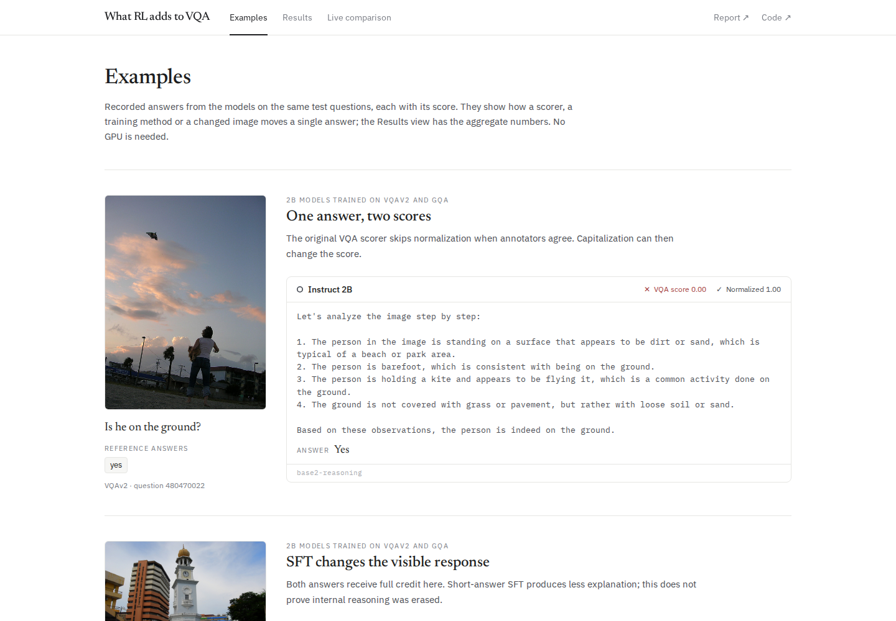

# What RL adds to a vision-language model's answers

A hands-on study of when reinforcement learning with a verifiable reward improves a
vision-language model beyond its starting point and beyond supervised fine-tuning. Qwen3-VL
at 2B and 8B is trained with short-answer SFT, GRPO with a correctness reward, and on-policy
distillation, then scored on fixed test questions under two prompt templates, a short answer
and step-by-step reasoning, with the dataset authors' evaluator and a normalized matcher, and
at milestones with an LLM judge audited by an image-aware model. **RL beats both the base model
and SFT where the data rewards what it optimizes: on ChartQA, where reasoning pays, it keeps
the reasoning and adds 10.4 points (5.5 under the audited judge); after SFT it gives the best
medical model; and on data it was not trained on it loses less than SFT, by one to two points on
general and medical images.** On short-answer VQAv2 and GQA it deletes the reasoning and only
matches SFT, and on medical data SFT alone beats it in domain; those results are reported as a
supplement.

The 2B pipeline runs on one 24 GB GPU; separate 80/96 GB profiles run the 8B recipes. The
recorded demo runs without a GPU.

## Main results

An RL arm counts as a win when it beats Instruct, and ideally SFT, on the test questions.
Official accuracy (%), greedy decoding, one training seed per arm. On ChartQA's 1,250
human-written test questions (2B), with the audited judge's score beside the reasoning prompt:

<!-- report:chartqa-headline -->
| Arm | Short | Reasoning | Reasoning, audited judge | Reasoning tokens |
| --- | ---: | ---: | ---: | ---: |
| Instruct 2B | 65.84 | 69.68 | 77.17 | 205 |
| SFT 2B (ChartQA) | 68.80 | 66.24 | 69.83 | 76 |
| Instruct → short-prompt GRPO (ChartQA, 1 epoch) | 67.52 | 75.60 | 79.57 | 177 |
| Instruct → GRPO (ChartQA, 1 epoch) | 66.72 | 80.08 | 82.62 | 162 |
| SFT → GRPO (ChartQA, 1 epoch) | 69.68 | 79.76 | 81.98 | 197 |
<!-- /report:chartqa-headline -->

**1. Where reasoning pays, RL beats both the base model and SFT, and more data keeps paying.**
ChartQA's human-written questions are the dataset where reasoning helped in screening (numeric
answers, +5.6 points). One epoch of GRPO with the reasoning prompt keeps the reasoning (162
tokens) and raises accuracy from 69.7 to 80.1 (+10.4, interval [+8.2, +12.6]); the audited
judge keeps half of that (+5.5, interval [+3.5, +7.4]), because many of Instruct's misses are
right answers in the wrong form ("20%" for 20). Both reasoning-trained arms end about ten
points above the best short-answer arm, SFT included, and the full epoch adds 3.7 points over a
300-update pilot. One seed, one dataset
([results](docs/supplementary/results.md#chartqa-rl-where-reasoning-pays)).

**2. Trained with reasoning, RL sharpens without narrowing.** Sampled 32 times per question,
reasoning-trained GRPO gains 13.3 points at pass@1 over Instruct and stays level at pass@32
(+0.5, interval [−0.7, +1.7]); short-prompt GRPO on the same data falls 9.0 points behind at
pass@32 ([results](docs/supplementary/results.md#chartqa-rl-where-reasoning-pays)).

Out of domain, at 2B with the short prompt (TextVQA official accuracy, VizWiz with the
authors' evaluator; neither dataset was trained on):

<!-- report:ood-headline -->
| Arm (2B, short prompt) | TextVQA | VizWiz |
| --- | ---: | ---: |
| Instruct 2B | 80.53 | 42.50 |
| SFT 2B | 80.08 | 42.53 |
| Instruct → short-prompt GRPO | 81.01 | 43.58 |
| SFT → short-prompt GRPO | 80.89 | 43.01 |
| SFT on the 4,000 RL questions | 80.12 | 42.39 |
<!-- /report:ood-headline -->

**3. Out of domain, RL keeps an edge over SFT.** Short-prompt GRPO beats one SFT epoch by 0.9
points on TextVQA (interval [+0.2, +1.6]) and by 1.0 on VizWiz ([+0.5, +1.6]). SFT on exactly
the 4,000 questions RL drew does not close the gap (RL leads it by 0.9 and 1.2), and the
audited judge keeps it on TextVQA (+0.8, [+0.2, +1.5]). About one point at 2B with one seed; at
8B the TextVQA difference is not significant
([results](docs/supplementary/results.md#out-of-domain-rl-keeps-an-edge-over-sft)).

**4. A reasoning habit learned on charts carries over to photos.** Trained only on ChartQA and
scored on photo questions under the reasoning prompt, GRPO keeps a shorter chain of reasoning
(66–83 tokens against Instruct's 107–148) and gains 15.2 points on VQAv2 and 15.9 on GQA,
while short-prompt accuracy moves by at most 0.6 points on any dataset
([results](docs/supplementary/results.md#transfer-between-training-data)).

**5. RL after SFT keeps the SFT ceiling and repairs what SFT broke.** GRPO from the SFT model
keeps short-prompt accuracy within 0.5 points of SFT on VQAv2 and GQA at both sizes and adds
up to 0.8 on TextVQA. At 8B, where SFT cost 10.8 points of short-prompt CLEVR counting, GRPO
with the reasoning prompt wins back 8.2 of them
([full matrix](docs/supplementary/supplement.md#prompt-template--scorer-variant)).

**6. On medical images, SFT then RL is the best model, and RL forgets less.** Of six medical
candidates, SLAKE and OmniMedVQA passed the screen. SFT followed by short-prompt GRPO is the best
model in all three settings tested: SLAKE at 2B and 8B (76.2 and 78.2, 1.3 and 1.0 points above
SFT) and OmniMedVQA with whole source collections held out for testing (+0.5 over SFT). The
margins are small; the 8B interval includes zero. GRPO alone gains less in domain but loses less
on medical data it did not train on: every SFT model drops 0.8–4.1 points on PathVQA while GRPO
stays within 1.8, a lead of 0.8–2.3 points. One seed; no patient-level split is available
([results](docs/supplementary/results.md#medical-images-sft-then-rl-is-the-best-model-and-rl-forgets-less)).

Differences below about 0.5 points under the reasoning prompt are within the run-to-run
noise of greedy vLLM decoding (three repeats of Instruct 2B span 0.4 points) and are not
claimed.

## Negative and null results

Reported in full, with the complete test matrix of every Part 1 arm and the per-run
diagnostics, in the [supplementary results](docs/supplementary/supplement.md):

- **On VQAv2 and GQA, RL deletes the reasoning, and most of its exact-match gain is answer
  form.** Under the reasoning prompt, GRPO adds 23.2 points on 2B VQAv2 by cutting responses
  from 148 tokens to 8; the audited judge leaves 4.4 of them (interval [+3.5, +5.4]), and the
  reasoning prompt still costs Instruct 3.8 points. A 0.2 format reward keeps 8B reasoning near
  130 tokens and scores 9.7 points below correctness-only GRPO on VQAv2
  ([judge](docs/supplementary/supplement.md#exact-match-misses-rescored-by-an-llm-judge)).
- **In domain, short-answer RL only matches SFT.** 1,000 updates add 0.8 and 0.9 points on
  VQAv2 and GQA, against 2.0 and 2.9 for one SFT epoch; one epoch of the whole 55,438-question
  pool reaches SFT's level and no further
  ([full pool](docs/supplementary/supplement.md#short-prompt-rl-on-the-full-pool)).
- **On VQA, RL narrows what the model can sample.** Short-prompt GRPO raises held-out pass@1
  by 2.4–3.0 points and lowers pass@32 by 1.9–7.6 (4.6–10.8 after the full pool); one SFT epoch
  does the reverse
  ([pass@k](docs/supplementary/supplement.md#held-out-passk-before-and-after-rl)).
- **Training knobs did not move results.** A filtered pool, dynamic sampling, 4× the batch and
  3× the learning rate stay within 0.35 points on VQA; eight ChartQA knobs (loss aggregation,
  KL, reward scaling, response cap, list-aware reward, canvas size, image geometry) read 0 at
  300 updates. The change that mattered was for correctness: rollouts from LoRA-merged weights
  lag the trained policy (up to 0.2 nats per token), and serving the adapter unmerged brings
  the gap under 0.01 ([recipe](docs/supplementary/supplement.md#recipe-experiments),
  [knobs](docs/supplementary/supplement.md#training-knobs-chartqa)).
- **One model on both dataset families does not learn when to reason.** Trained on VQA and
  ChartQA together, it keeps chart reasoning for 1,750 updates, then collapses to 10-token
  answers everywhere and ends 14.2 points below the ChartQA-trained model on ChartQA
  ([mixture](docs/supplementary/supplement.md#one-model-on-both-families)).
- **On medical images, SFT beats RL from the base model in domain and on unseen
  collections.** On SLAKE one SFT epoch leads one epoch of short-prompt GRPO from Instruct by
  9.2 points at 2B and 8.9 at 8B (RL after SFT closes the gap); on OmniMedVQA collections never
  trained on, SFT on the same 4,916 questions leads GRPO by 4.1 points; OmniMedVQA's image-level
  split is too easy to measure anything (SFT 99.7%)
  ([medical pilots](docs/supplementary/supplement.md#medical-pilots-in-detail)).
- **Rejected at screening.** CLEVR compositional (nearly saturated; reasoning costs it 5.6
  points), MedThinkVQA (answered from the case text at 2B and 8B), and Kvasir-VQA-x1, PathVQA
  and ReXVQA (images change the answers by under 10 points; a black chest X-ray leaves
  ReXVQA's accuracy unchanged)
  ([screening](docs/supplementary/evaluation.md#dataset-screening)).

## What was trained

| Arm | Supervision |
|---|---|
| SFT | one epoch on 39,458 VQAv2 and GQA short answers |
| Instruct → GRPO, SFT → GRPO | 1,000 GRPO updates under the reasoning prompt, correctness reward: the tagged answer, scored by the normalized matcher |
| Instruct → short-prompt GRPO, SFT → short-prompt GRPO | the same 1,000 updates under the short prompt, rewarding the whole answer (64-token budget) |
| Instruct → gold-conditioned OPD (2B) | 1,000 updates of token-level feedback from the frozen Instruct model, shown the reference answer |

Every RL arm draws its questions in the same seeded order from a 55,438-question pool,
four questions and eight sampled responses per update, learning rate 1e-5, no KL penalty.
Rollouts come from vLLM serving the current LoRA adapter unmerged, so the sampled policy is
the trained one. SFT → GRPO adds the SFT epoch on top, so it measures the value of SFT
before the same RL. The recipe was frozen after one-change experiments against a fixed
baseline ([results](docs/supplementary/supplement.md#recipe-experiments)). No dev or test image
appears in any training pool; the split files in `data/splits/` list every row and
`check_data` verifies it. The [method](docs/supplementary/method.md) has the full recipe and
the commands that reproduce each arm.

## Evaluation

| Dataset | Test questions | Official scorer |
|---|---:|---|
| VQAv2 | 5,000 | VQA ten-annotator accuracy with its answer processing |
| GQA | 12,578 | exact answer match |
| CLEVR counting | 3,000 | exact count |
| TextVQA (far-OOD) | 5,000 (all of validation) | MMF/EvalAI answer processing, ten-annotator accuracy |

These are fixed subsets materialized by this repository, not benchmark-server
submissions; GQA's consistency and grounding metrics are outside an accuracy score. The
official scorers reproduce the authors' evaluator code on 626,074 saved predictions from
89 runs with no per-question mismatch ([validation](docs/supplementary/validation.md)).
The [evaluation](docs/supplementary/evaluation.md) page describes the harness in the terms
public harnesses use and lists where it departs from their practice. Run side by side with
lmms-eval on the same model, the scorers agree exactly and GQA matches within 0.09 points;
the 1.15-point TextVQA gap comes from lmms-eval capitalizing each question.

The scorer matters under the reasoning prompt. The authors' evaluators compare some
answers case-sensitively (VQAv2 when all annotators agree, GQA always), and for Instruct
2B lowercasing the answers closes nearly all of the official-to-normalized gap: 9.6 of 9.6
points on VQAv2 and 14.7 of 15.8 on GQA. Both numbers are always reported side by side.

`evaluate.py` runs one model under a declared protocol (dataset, role, tier, prompt,
decoding, image mode) and writes a record with both scorer variants and every prediction.
A cell that already has a record is skipped, and an interrupted one resumes. Every table
in this repository, and the dashboard, is generated from those records:

```bash
uv run --frozen python -m scripts.report
```

## Try it

Browse recorded examples and the results dashboard, no GPU needed:

```bash
uv sync --frozen --group demo
cd demo/frontend && npm ci && npm run build && cd ../..
uv run --frozen uvicorn demo.backend.app:app --host 127.0.0.1 --port 8000
```

Open `http://127.0.0.1:8000`. The [demo notes](demo/README.md) cover live inference with
the three 2B models on a 24 GB GPU.



The [tutorial](docs/tutorial.md) runs the 2B pipeline on one 24 GB GPU: data, split check,
evaluation, the learnability pre-check, two-step SFT and GRPO runs with their dev-tier
learning curves, and the tables. The [hardware notes](docs/supplementary/hardware.md)
cover the 80/96 GB profiles, resumption, and measured memory; [monitoring](docs/supplementary/monitoring.md)
covers what to watch while an RL run trains and how to plot it.

## History and corrections

The first campaign, in July 2026, trained GRPO with a VQAv2 reward that paid nothing on
single-reference training questions, and its training pools shared 47 images with the
VQAv2 test subset. The corrected campaign of September 13 fixed both, with 300-update RL
runs sampled from merged weights; the final rerun above replaced it under the frozen recipe.
The [history](docs/supplementary/history.md) keeps both earlier campaigns as labeled
history, the full erratum for the reward defect, and a ledger of every published claim with
its status: replicated, qualified, not replicated, retracted, or open.

The adapters published in July come from those runs. All four were trained on the July
pools, and the two GRPO adapters also carry the reward defect:

| Adapter | Download |
|---|---|
| 2B SFT | [vqa-rlvr-sft-2b](https://huggingface.co/omnifish123/vqa-rlvr-sft-2b) |
| 8B SFT | [vqa-rlvr-sft-8b](https://huggingface.co/omnifish123/vqa-rlvr-sft-8b) |
| 2B GRPO from Instruct | [vqa-rlvr-grpo-2b-main-base](https://huggingface.co/omnifish123/vqa-rlvr-grpo-2b-main-base) |
| 2B SFT then GRPO | [vqa-rlvr-grpo-2b-main-sft](https://huggingface.co/omnifish123/vqa-rlvr-grpo-2b-main-sft) |

## Repository map

- `train_sft.py`, `train_grpo.py`, `train_opd.py`: training entry points on shared
  plumbing in `vqar/training.py` and `vqar/rl.py`; presets and hardware profiles in
  `vqar/config.py`.
- `vqar/registry.py`: datasets, their roles and scorers, and prompt templates, registered
  once.
- `vqar/eval/`: the evaluation harness, records, the experiment matrix, and the report
  builder.
- `evaluate.py`, `scripts/`: evaluation, data checks, the learnability pre-check,
  reports, and the gallery.
- `data/splits/`, `experiments.toml`, `results/records/`: the split files, the declared
  arms and protocols, and the evaluation records behind every table.
- `demo/`: recorded examples, the results dashboard, and optional live comparison.
- `tests/`: CPU tests; GitHub Actions runs them without PyTorch.

## Acknowledgments

Built with Qwen, Hugging Face Transformers, TRL, PEFT, and vLLM. Dataset and model
licenses apply to their respective assets. See [LICENSE](LICENSE) for this code.
