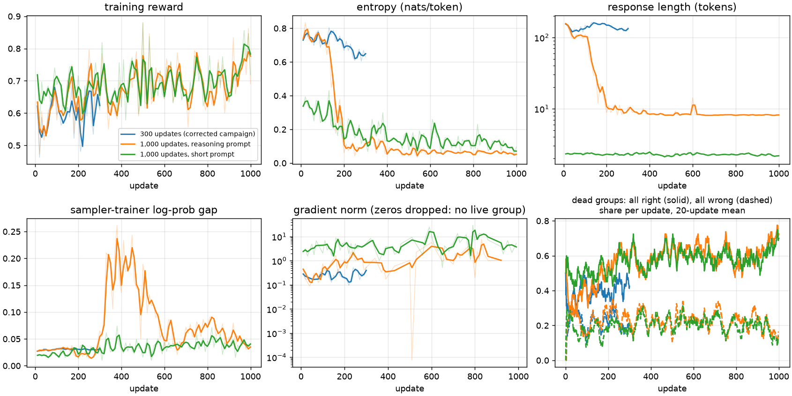

# Monitoring RL runs

This page covers what to watch while a GRPO run trains, where each number comes from, and
what to check when one looks wrong. The examples are real runs from this repository.

## Where the signals are

| File (under the run directory) | Written | Holds |
|---|---|---|
| `metrics.jsonl` | every 10 updates, plus events | the Trainer's logged signals, averaged over those 10 updates; `start`, `resume`, `checkpoint`, `done` events |
| `prompt_draws.jsonl` | every update | every rollout's question ID and score; the dead-group split is computed from it |
| `checkpoints/completions/*.parquet` | every 10 updates | sampled responses with their reward and advantage |
| `checkpoints/dev-records/` | after training | greedy dev accuracy of every kept adapter, both prompts (the learning curve) |

```bash
# Windowed table and warning flags; works on a partial metrics.jsonl while the run trains.
uv run --frozen python -m scripts.watch_training <run>/metrics.jsonl --window 100
# Figures: training health, and dev curves with one-standard-error bars.
uv run --frozen --group plots python -m scripts.plot_training <run> [<run> ...] \
  --labels "name" ... --out health.png --curves curves.png
```

## What to watch

Training reward is measured on the questions being trained on, so it can rise while
nothing that matters improves. The dev curves are the progress signal. The other
signals show whether training is healthy.

| Signal (`metrics.jsonl` key) | Healthy here | Warning sign | Check first |
|---|---|---|---|
| Training reward (`reward`) | 0.55–0.8, noisy | a jump of more than 0.15 between windows | read sampled completions |
| Dead groups (`frac_reward_zero_std`, and all right / all wrong from the draws) | 0.4–0.6 at the start | above 0.8 | all right: the pool is too easy; all wrong: too hard |
| Entropy (`entropy`) | 0.6–0.8 per token with reasoning, 0.1–0.4 with short answers | below a quarter of its start | response length; the dev curve under the reasoning prompt |
| Response length (`completions/mean_length`) | 100–160 tokens with reasoning | below a quarter of its start | whether the responses still reason (read them) |
| Truncation (`completions/clipped_ratio`) | below 2% | above 5% | the completion budget |
| Sampler–trainer gap (`sampling/sampling_logp_difference/mean`) | 0.02–0.04 | above 0.1 | whether vLLM received the current weights; the importance-sampling ratio |
| Clipping (`clip_ratio/region_mean`) | 0 with one pass per batch | above 0.001 | whether `num_iterations` or the batch split changed |
| Gradient norm (`grad_norm`) | 0.1–1 with reasoning, 1–10 with short answers | sustained growth | the learning rate; logged zeros mean no group had a gradient |

The thresholds are rules of thumb taken from these runs, not calibrated limits.
`scripts/watch_training.py` prints a `FLAG` line for each of them.



The figure compares three runs from Instruct 2B that train on the same question order,
one change at a time. The corrected campaign run takes 300 updates with the learning rate
decaying to 0 at update 300; the other two take 1,000 updates under the same schedule
stretched to 1,000.

## Patterns and what they meant

**Reasoning pruned.** With 1,000 updates under the reasoning prompt, response length fell
from about 157 tokens to 9 between updates 100 and 200, entropy fell from 0.74 to 0.06, and
the sampled responses became a bare `<answer>bed</answer>`. Reward did not drop, so the
correctness reward pays nothing for the reasoning. The 300-update run kept 130–150 tokens;
its whole learning-rate budget equals the 1,000-update run's by update 155, where the
collapse starts. That is a proposed explanation, not a tested one. This is a policy change
rather than a bug: check it against the dev curve under the reasoning prompt, not
against the training reward.

**Dead groups rise as the model improves.** In every run the all-right share grew (about
0.4 → 0.7 over 1,000 updates), so later updates learn from fewer groups. A pool filtered
by the starting model goes stale in the same way; refilling dead groups
(`--refill-rounds`) targets this.

**Sampler–trainer gap episode.** In the 1,000-update reasoning run the gap rose from 0.03
to about 0.2 between updates 300 and 550, then returned to 0.04, while responses moved
from `<answer>no</answer>` to a spaced `<answer> no </answer>`. The cause is not yet
established. `scripts/check_logprob_gap.py` tests it outside training: it samples rollouts
as training does, scores the same tokens with the trainer's forward, and splits the gap by
answer form and by the sampled token's probability. The importance-sampling correction (`sequence_mask`, ratio capped at 3)
bounds the effect of such tokens on the update. A gap that grows steadily and does not
come back would point to a weight-synchronization fault instead, the kind of fault the
retired NF4 student presets produced ([hardware](hardware.md)). Part of the gap is bf16
rounding of the merged weights: after 300 updates the check gave 0.132 with merged weights
in vLLM and 0.011 with merged weights on both sides. `--rollout-lora` serves the adapter
unmerged instead ([method](method.md#training-recipe)).

**Short answers have large, spiky gradient norms.** With one to three tokens per response,
each token carries a larger share of the loss; norms of 1–10 with spikes to 30 were normal
and did not destabilize the reward.

## Dev curves

The dev role is small (VQAv2 447 questions, GQA 59), so one standard error is about
2 points on VQAv2 and 6 on GQA. Read changes between saves against the error bars, and
choose checkpoints on dev, never on the test roles. Headline comparisons come from the
full test roles with paired bootstrap intervals ([evaluation](evaluation.md)).

## Cluster jobs

Job failures are a separate layer: a job that dies within seconds on the GPU check is a
bad node, and one that dies at vLLM start-up offline usually lacks a model file in the
cluster cache. [Hardware](hardware.md) lists the cases seen and their fixes.
